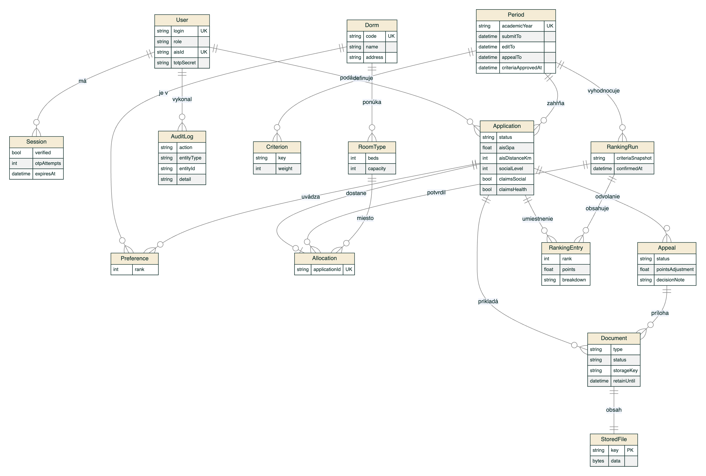

# Doplnenie DNR – kapitoly 5 a 6

> Aktuálna verzia dokumentu je `SWI1_W1_Ziadost_o_ubytovanie_B_5.docx` (verzia 1.7) – požiadavky S.01 – S.42 v tvare „Systém bude …“. Tento súbor obsahuje podklady ku kapitolám 5 a 6.
Podklady k dokumentu *Detailný návrh riešenia – Žiadosť o ubytovanie B*. Kapitola 5
nahrádza vzorový diagram (Project/Employee), kapitola 6 opisuje prototyp, ktorý je
v tomto repozitári.

---

## 5 Konceptuálny dátový model

*Obrázok 12 – Konceptuálny dátový model*

### 5.1 Popis entít

| Názov entity | Popis |
|---|---|
| **User** (Používateľ) | Osoba prihlásená univerzitným kontom. Rola určuje, čo v systéme vidí: študent, referent, ubytovacia komisia alebo správca internátov. Študent má prepojenie na akademický IS (aisId). Systém nevedie heslá (E.01), uchováva iba tajomstvo pre druhý faktor, počet nesprávnych kódov a prípadné dočasné zablokovanie konta (po 5 chybách na 15 minút). |
| **Session** (Relácia) | Prihlásenie používateľa. Platí až po overení druhým faktorom (S.07). |
| **Period** (Konanie) | Konanie pre jeden akademický rok s termínmi podávania, úprav a odvolaní (S.11) a dátumom schválenia kritérií komisiou (E.03). |
| **Criterion** (Kritérium) | Merateľný údaj vstupujúci do výpočtu poradia (prospech, vzdialenosť bydliska, sociálna situácia, osobitné potreby) s váhou v bodoch. Súčet váh konania je 100. |
| **Dorm** (Internát) | Ubytovacie zariadenie univerzity s adresou a skratkou. |
| **RoomType** (Typ izby) | Typ izby v internáte (počet lôžok) a počet miest, ktoré sa dajú prideliť (S.16). |
| **Application** (Žiadosť) | Žiadosť študenta o ubytovanie v konaní. Obsahuje údaje prevzaté z AIS (S.02), kontakt, uplatnené osobitné okolnosti, posúdenie sociálnej situácie a stav (E.09). Študent má v konaní najviac jednu žiadosť (E.08). |
| **Preference** (Preferencia) | Poradie internátov, v ktorých chce študent bývať (S.14). |
| **Document** (Doklad) | Príloha žiadosti alebo odvolania (potvrdenie o príjme, zdravotný doklad, príloha k odvolaniu) so stavom overenia, poznámkou referenta a dátumom, do ktorého sa uchováva (S.03, S.06, S.12). |
| **StoredFile** (Uložený súbor) | Šifrovaný obsah dokladu (AES-256-GCM). Oddelený od metadát, aby sa po uplynutí doby uchovávania dal zmazať, kým záznam o doklade zostane v audite. |
| **RankingRun** (Výpočet poradia) | Jeden beh výpočtu so snímkou kritérií a váh. Vďaka nej sa výpočet dá kedykoľvek zopakovať a doložiť (S.05, G.04). |
| **RankingEntry** (Umiestnenie) | Poradie a body žiadosti v danom výpočte vrátane rozpisu podľa kritérií a navrhnutého typu izby. |
| **Allocation** (Pridelenie) | Potvrdené pridelenie miesta v type izby. Potvrdzuje ho referent (SW.03), počet pridelení nikdy neprekročí kapacitu (E.07). |
| **Appeal** (Odvolanie) | Odvolanie študenta proti rozhodnutiu o pridelení, rozhodnutie komisie a prípadná úprava bodov (S.15). |
| **AuditLog** (Auditný záznam) | Nemenný záznam o zmenách bodov, posúdení dokladov, rozhodnutiach a nastaveniach: kto, čo, kedy, hodnota pred a po (S.13). |
| **EmailLog** (Odoslaný e-mail) | Záznam e-mailových upozornení študentom (S.10). |

### 5.2 Popis relácií

| Názov entity | Názov entity | Popis |
|---|---|---|
| User | Application | Študent podáva v každom konaní najviac jednu žiadosť (1 : 0..N, unikátne v rámci konania). |
| User | Session | Používateľ môže mať viac relácií (1 : 0..N). |
| User | AuditLog | Každý auditný záznam má autora; automatické akcie systému autora nemajú (0..1 : 0..N). |
| Period | Criterion | Konanie definuje kritériá a ich váhy, každé kritérium raz (1 : 1..N). |
| Period | Application | Konanie zahŕňa žiadosti podané v danom akademickom roku (1 : 0..N). |
| Period | RankingRun | V konaní sa poradie môže počítať opakovane (1 : 0..N). |
| Dorm | RoomType | Internát ponúka jeden alebo viac typov izieb s kapacitou (1 : 1..N). |
| Application | Preference | Žiadosť uvádza zoradený zoznam internátov (1 : 0..N). |
| Dorm | Preference | Internát sa môže objaviť v preferenciách viacerých žiadostí (1 : 0..N). |
| Application | Document | Žiadosť má doklady; pri doplnení vzniká nová verzia, staršie zostávajú v histórii (1 : 0..N). |
| Document | StoredFile | Každý doklad má práve jeden šifrovaný obsah (1 : 1). |
| Application | Allocation | Žiadosť dostane najviac jedno pridelené miesto (1 : 0..1). |
| RoomType | Allocation | Do typu izby sa pridelí najviac toľko miest, aká je jeho kapacita (1 : 0..N). |
| RankingRun | RankingEntry | Výpočet obsahuje umiestnenie každej vyhodnocovanej žiadosti (1 : 1..N). |
| Application | RankingEntry | Žiadosť má umiestnenie v každom výpočte, do ktorého vstúpila (1 : 0..N). |
| RankingRun | Allocation | Pridelenie vzniklo potvrdením konkrétneho výpočtu, alebo ručne mimo neho (0..1 : 0..N). |
| Application | Appeal | Študent môže podať odvolanie, súčasne sa posudzuje najviac jedno (1 : 0..N). |
| Appeal | Document | K odvolaniu možno priložiť doklad (1 : 0..N). |

---

## 6 Prototyp

### 6.1 Cieľ prototypu

Prototyp overuje oblasti, v ktorých sú najväčšie riziká návrhu:

1. **Výpočet poradia a pridelenie bez prekročenia kapacity** – či sa poradie dá vypočítať
   deterministicky, zopakovať zo zapamätaných vstupov a či potvrdenie pridelenia neprekročí
   kapacitu ani pri súbežnom spracovaní (S.05, S.08, E.07, G.04).
2. **Prihlásenie s druhým faktorom a prístup len k vlastnej žiadosti** (S.07, E.01).
3. **Bezpečné uloženie citlivých dokladov** – šifrovanie, kontrola prístupu a zmazanie po
   uplynutí doby uchovávania (S.12, E.04).
4. **Stavový automat žiadosti** – žiadosť je vždy v jednom stave a prechody sú definované (E.09).
5. **Použiteľnosť a prístupnosť** – študent dokončí žiadosť aj na mobile, web spĺňa WCAG (E.06).

| Oblasť | Výber | Zdôvodnenie |
|---|---|---|
| Prog. jazyk a framework | TypeScript, Next.js 16 (App Router, Server Actions) | Frontend aj backend v jednom projekte, typová kontrola od databázy po formulár, serverové akcie zjednodušujú overovanie práv pri každej zmene. |
| UI framework | React 19, Tailwind CSS 4, vlastné komponenty | Plná kontrola nad vzhľadom a prístupnosťou, žiadna závislosť od šablóny. |
| Databáza | SQLite / libSQL cez Prisma ORM 7 | Lokálne bez inštalácie servera, v produkcii Turso (libSQL). Transakcie pre kontrolu kapacity, migrácie, typovo bezpečné dotazy. |
| Hosting | VPS (Ubuntu 26.04), Caddy, systemd – https://swi.becode.sk | Citlivé doklady zostávajú na vlastnom serveri, automatické HTTPS cez Let's Encrypt, denná záloha databázy a mazanie dokladov. Pripravené je aj nasadenie na Vercel + Turso. |
| Repozitár | GitHub (github.com/martinos133/SWI) | Spoločná práca tímu, história zmien po fázach. |
| Vývojové prostredie (IDE) | Visual Studio Code, Claude Code | Podpora TypeScriptu a Tailwindu. |
| Testovanie | Vitest (unit), Playwright (E2E), axe-core (prístupnosť) | Overenie výpočtu, stavov, celých tokov všetkých rolí a WCAG 2.2 AA. |
| Bezpečnosť | AES-256-GCM, TOTP (otplib), httpOnly session cookie | Šifrované doklady, druhý faktor kompatibilný s aplikáciou Authenticator, žiadne heslá v systéme. |
| Integrácie (API.01 – API.03) | Simulovaný AIS, simulované SSO, Nodemailer | Rozhrania sú oddelené v samostatných moduloch, reálne napojenie nahradí iba ich vnútro. |

### 6.2 Výsledok experimentu

Prototyp pokrýva všetky požiadavky Must (S.01 – S.42) a prípady použitia UC.01 – UC.10
pre všetky štyri roly. Overené bolo:

- celý priebeh konania od podania žiadosti cez overenie dokladov, výpočet poradia a pridelenie
  až po odvolanie a rozhodnutie komisie,
- výpočet poradia je deterministický; každý uložený výpočet systém pri zobrazení zopakuje zo
  zapamätaných vstupov a overí, že body sa zhodujú,
- pridelenie rešpektuje preferencie a kapacitu – študent nižšie v poradí môže dostať miesto,
  ak jeho preferovaný internát ešte nie je plný, a naopak (obrázok 24),
- študent vidí iba vlastnú žiadosť a doklady, iný študent dostane pri pokuse o prístup k
  cudziemu dokladu chybu 403,
- 19 unit testov a 20 end-to-end testov prechádza (výstup v docs/screenshots/24-vysledky-testov.png); záťažový test (50 súbežných používateľov, 30 s) spracoval 2 828 požiadaviek bez chyby, 99 % odpovedí do 1,0 s; každá obrazovka každej roly spĺňa
  WCAG 2.2 AA podľa automatickej kontroly axe a na šírke 375 px nemá vodorovný posun.

**Screenshoty** (súbory v priečinku `docs/screenshots`):

| Obrázok | Súbor | Popis |
|---|---|---|
| 13 | 01-prihlasenie.png | Úvodná stránka s termínmi konania |
| 14 | 02-univerzitne-sso.png, 03-dvojfaktorove-overenie.png | Prihlásenie univerzitným kontom a druhý faktor (UC.01) |
| 15 | 04-student-bez-ziadosti.png | Prehľad študenta pred podaním žiadosti |
| 16 | 05-formular-ziadosti.png | Žiadosť s údajmi z AIS, preferenciami a priebežným ukladaním (UC.02) |
| 17 | 06-student-ziadost-podana.png, 07-student-caka-na-doplnenie.png | Stav žiadosti a priebeh konania (UC.04) |
| 18 | 08-doklady-vyzva-na-doplnenie.png | Doklady s poznámkou referenta (UC.03) |
| 19 | 09-referent-zoznam-ziadosti.png | Zoznam žiadostí pre referenta |
| 20 | 10-referent-posudenie-dokladov.png | Posúdenie dokladov a história žiadosti (UC.06) |
| 21 | 11-referent-terminy.png, 23-vyber-datumu.png | Správa termínov a výber dátumu z kalendára (UC.10) |
| 22 | 12-komisia-kriteria-a-vahy.png | Kritériá a váhy so simuláciou výpočtu (UC.10) |
| 23 | 13-spravca-kapacity.png | Kapacity internátov (UC.10) |
| 24 | 14-poradie-navrh-pridelenia.png, 15-potvrdenie-pridelenia.png | Výpočet poradia a potvrdenie pridelenia (UC.07) |
| 25 | 16-student-pridelene-miesto.png | Pridelené miesto a body študenta |
| 26 | 17-student-odvolanie.png, 18-komisia-rozhodnutie-o-odvolani.png | Odvolanie a rozhodnutie komisie (UC.05, UC.08) |
| 27 | 19-auditny-zaznam.png, 20-odoslane-emaily.png | Auditný záznam a e-mailové upozornenia (UC.09) |
| 28 | 21-mobil-pridelene-miesto.png, 22-mobil-formular.png | Mobilné zobrazenie |

**Problémy a riešenia**

| Problémy | Riešenie |
|---|---|
| Next.js 16 má predvolene zapnuté *Cache Components*, pri ktorých čítanie session mimo `<Suspense>` končí chybou buildu. Aplikácia je celá za prihlásením. | Cache Components sme vypli – statický shell by pri stránkach závislých od prihláseného používateľa nič neušetril. |
| Najnovšia verzia Prisma bola iba 8 RC a s ňou prišli konflikty závislostí. | Pripli sme stabilnú Prisma 7.10 s adaptérom libSQL. |
| Lokálne nebežal Docker ani PostgreSQL. | SQLite cez libSQL – nevyžaduje server a v produkcii ho nahradí Turso bez zmeny kódu. |
| Serverless hosting (Vercel) nemá trvalý disk, doklady uložené do súborov by sa stratili. | Šifrovaný obsah dokladov ukladáme do databázy (entita StoredFile), aplikácia tak beží na VPS aj na serverless hostingu. |
| Build Next.js na serveri s 2 GB RAM. | Na VPS sme pridali 2 GB swap; aplikácia samotná potrebuje asi 300 MB. |
| Kapacita sa nesmie prekročiť ani vtedy, keď dvaja referenti potvrdia pridelenie súčasne. | Potvrdenie beží v jednej transakcii, ktorá výpočet „zaberie“ podmienenou aktualizáciou a pred každým pridelením znova spočíta obsadenosť. |
| Úprava bodov po odvolaní by zmenila uložený výpočet a ten by sa už nedal zopakovať. | Úprava sa ukladá k odvolaniu a do auditu, pôvodný výpočet zostáva nezmenený. |
| Automatická kontrola prístupnosti (axe) našla nedostatočný kontrast šedého textu (4,4 : 1) a niektorých odznakov. | Upravili sme farebné tokeny na pomer aspoň 4,5 : 1; kontrola je súčasťou E2E testov. |
| Na mobile sa formulár žiadosti posúval do strany. | Mriežka formulára má explicitný stĺpec `minmax(0, 1fr)`; E2E test kontroluje vodorovný posun na každej stránke. |
| Reálne univerzitné SSO, AIS a mailový server nie sú pre prototyp k dispozícii. | Rozhrania API.01 – API.03 sú simulované v samostatných moduloch; e-maily sa zapisujú do logu a dajú sa pozrieť v aplikácii. |
